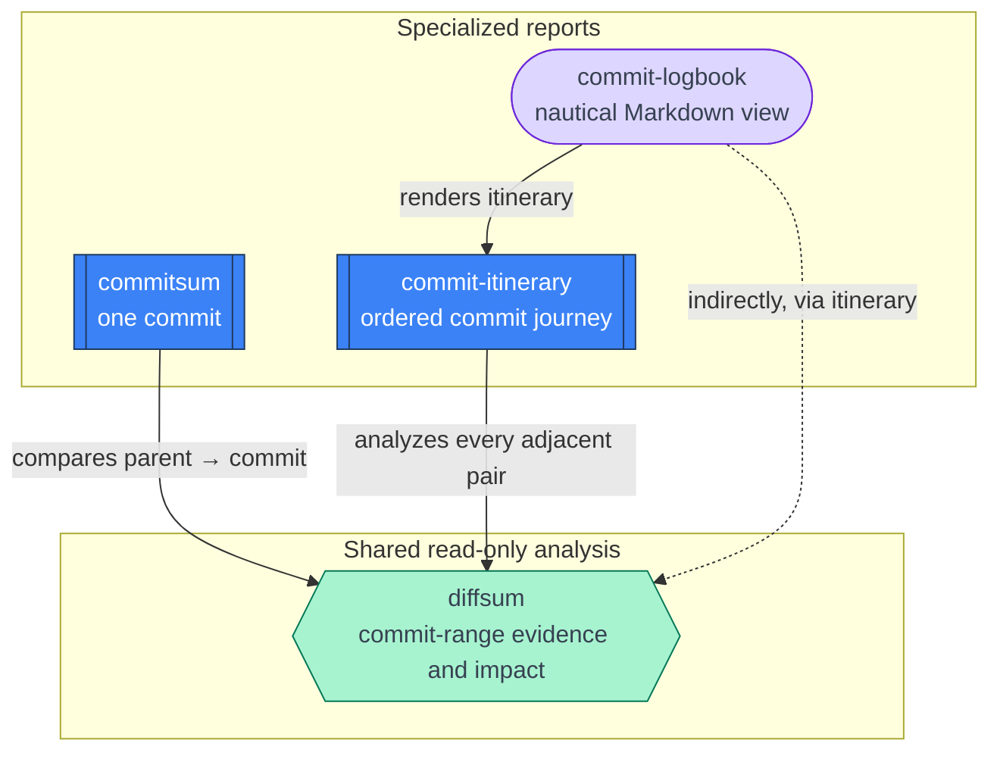

# Commit Sums

A small, composable set of read-only Git-history skills for Codex and other
agents that support the [Agent Skills](https://agentskills.io) convention. They
turn commits and commit ranges into evidence-based briefings without changing
the repository.

## Included skills

| Skill | Use it for | Example invocation |
| --- | --- | --- |
| `commitsum` | Explain one commit, including intent and impact. | `Summarize commit a1b2c3d.` |
| `diffsum` | Compare two commits or revisions. | `What changed from a1b2c3d to e4f5g6h?` |
| `commit-itinerary` | Narrate an ordered series of commit transitions. | `Create a commit itinerary for the last three commits.` |
| `commit-logbook` | Render a commit itinerary as a nautical Markdown logbook. | `Create a commit logbook for a1b2c3d, e4f5g6h, and i7j8k9l.` |

## Invocation examples

### `commitsum`

- `Commitsum a1b2c3d.`
- `Summarize commit a1b2c3d.`
- `What did commit a1b2c3d change?`
- `Explain HEAD as a commit briefing.`
- `$commitsum release-2026-10`
- Summarize last commit.

### `diffsum`

- `Diffsum a1b2c3d e4f5g6h.`
- `What changed from a1b2c3d to e4f5g6h?`
- `Compare HEAD~5 with HEAD.`
- `Give me the intent and practical impact of release-2026-09..release-2026-10.`
- `$diffsum main feature/new-routing`

### `commit-itinerary`

- `Create a commit itinerary for the last three commits.`
- `Walk me through a1b2c3d → e4f5g6h → i7j8k9l.`
- `Tell the history across these commits: a1b2c3d, e4f5g6h, i7j8k9l.`
- `Map the engineering journey from release-2026-09 through release-2026-10.`
- `$commit-itinerary a1b2c3d e4f5g6h i7j8k9l`

### `commit-logbook`

- `Create a commit logbook for the last three commits.`
- `Logbook this journey: a1b2c3d → e4f5g6h → i7j8k9l.`
- `Tell this commit history as a ship's log: a1b2c3d, e4f5g6h, i7j8k9l.`
- `Give me a nautical Markdown logbook for release-2026-09 through release-2026-10.`
- `$commit-logbook the last five commits`

## Skill relationships



`diffsum` supplies the shared analysis: range inspection, evidence for intent,
and practical-impact checks. The higher-level skills keep their own context and
presentation:

- `commitsum` adds single-commit metadata and root/merge handling.
- `commit-itinerary` connects adjacent comparisons into a journey.
- `commit-logbook` applies the nautical Markdown presentation.

## Installation

Clone this repository, then copy the skills you want into your agent's skill
directory. For Codex, the personal skill directory is `~/.codex/skills/`:

```sh
cp -R skills/commitsum ~/.codex/skills/
cp -R skills/diffsum ~/.codex/skills/
cp -R skills/commit-itinerary ~/.codex/skills/
cp -R skills/commit-logbook ~/.codex/skills/
```

Install dependencies together: `commitsum` and `commit-itinerary` require
`diffsum`; `commit-logbook` requires `commit-itinerary` and `diffsum`.

Other compatible agents commonly discover repository skills from
`.agents/skills/`, `.claude/skills/`, or `.github/skills/`; copy the desired
skill directories to the location supported by your agent.

## Safety and evidence

All included skills are read-only: they do not pull, fetch, reset, switch
branches, or modify the worktree.

The summaries distinguish stated reasons (pull-request context or commit
messages) from inference. They identify dependency, migration, configuration,
API, renamed-file, and tooling impacts where the Git evidence supports them.

## Repository layout

```text
skills/
├── commitsum/
├── diffsum/
├── commit-itinerary/
└── commit-logbook/
```

## License

Licensed under the [MIT License](LICENSE).
